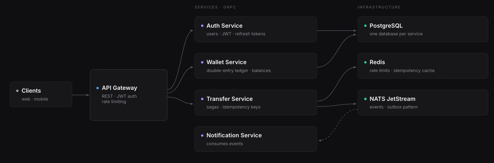
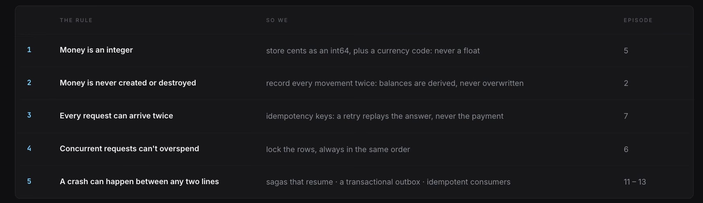

# Go Wallet

A Go microservices project for money transfers and wallet management, designed with production reliability in mind.

**Status:** Planning stage. This repository currently contains architecture and money-handling rules; services and setup instructions will be added as implementation progresses.

## Architecture

Web and mobile clients connect to a REST API gateway. The gateway routes requests to services over gRPC, while asynchronous events support notifications.

| Component | Responsibility |
| --- | --- |
| API Gateway | REST endpoints, JWT authentication, and rate limiting |
| Auth Service | Users, JWTs, and refresh tokens |
| Wallet Service | Double-entry ledger and wallet balances |
| Transfer Service | Transfer orchestration using sagas and idempotency keys |
| Notification Service | Consume events and send notifications |

### Planned infrastructure

- **PostgreSQL:** One database per service for persistent data.
- **Redis:** Rate limiting and idempotency caching.
- **NATS JetStream:** Event delivery with a transactional outbox pattern.

## Money-handling rules

1. **Use integers for money.** Store amounts in the currency's smallest unit using `int64`, alongside a currency code. Never use floating-point values.
2. **Preserve money through double-entry accounting.** Record every movement with balanced ledger entries. Derive balances from the ledger instead of overwriting them.
3. **Make requests idempotent.** Use idempotency keys so retries return the original result without repeating a payment.
4. **Prevent concurrent overspending.** Lock affected rows within a database transaction, always in a consistent order.
5. **Recover safely from crashes.** Use resumable sagas, a transactional outbox, and idempotent event consumers.

